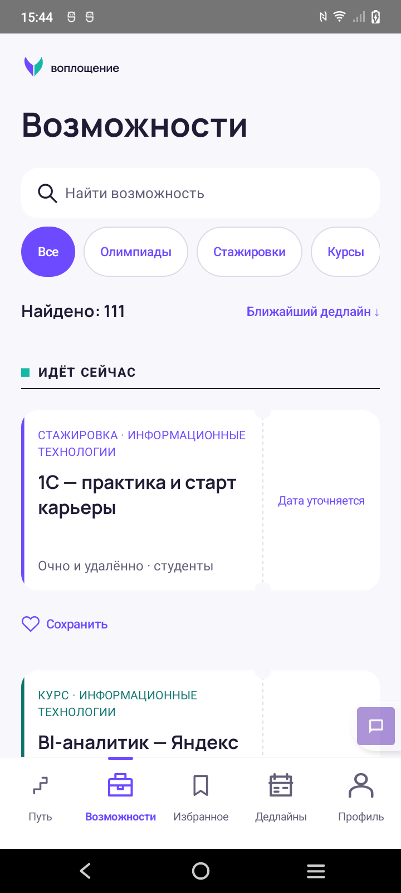
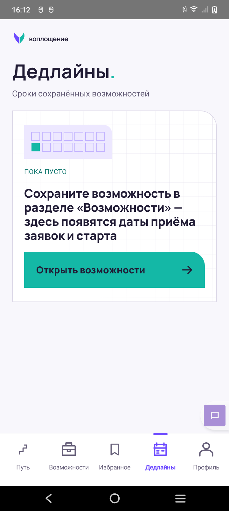
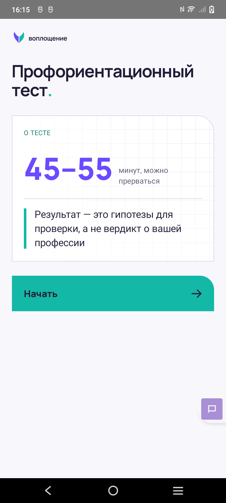
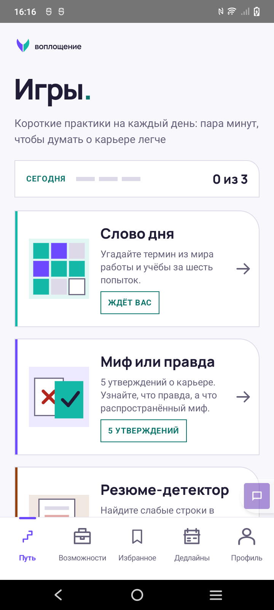
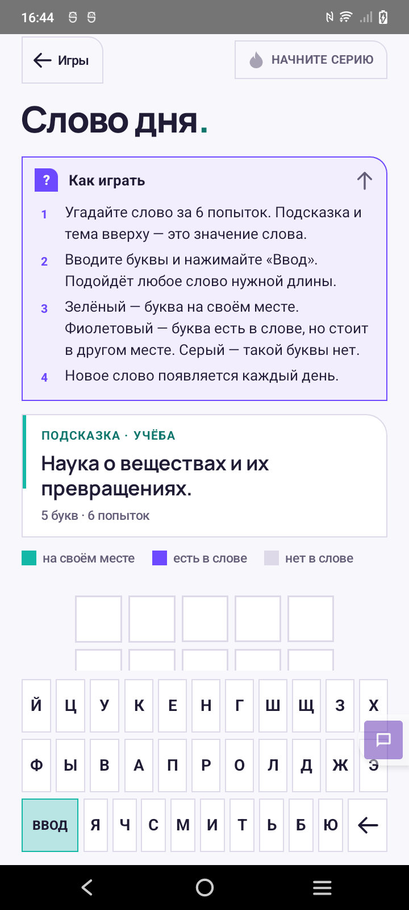
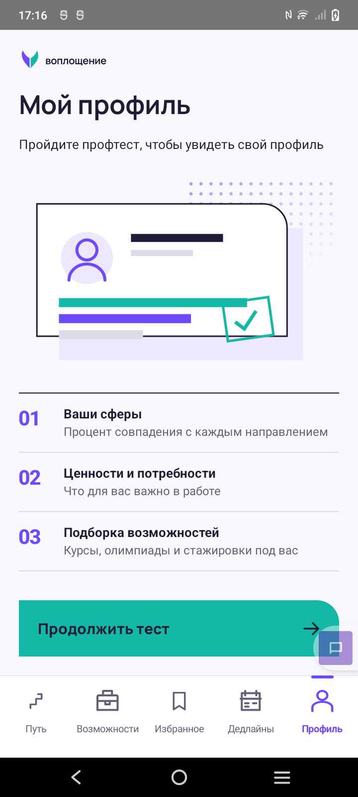
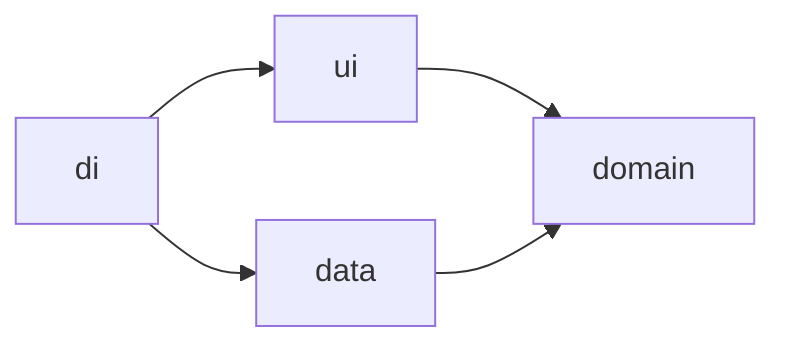

# Воплощение

Профориентационный тест и каталог возможностей для школьников и студентов: олимпиады, стажировки, курсы, события.
После теста пользователь получает профиль по сферам и подборку возможностей, сохраняет понравившиеся и следит за дедлайнами. Для ежедневной практики есть мини-игры: «Слово дня», «Миф или правда», «Резюме-детектор».

**Онлайн-версия:** https://vopl-two.vercel.app

| Часть | Стек | Папка |
|---|---|---|
| Android-приложение | Kotlin, Jetpack Compose, Room, Hilt | `app/` |
| Веб-версия | HTML, CSS, JavaScript (ES-модули), без сборки | `web/` |
| Данные и скрипты | каталог, конфигурация теста, генерация ассетов | `data/`, `tools/` |

| Каталог по дедлайнам | Дедлайны | Старт теста |
|---|---|---|
|  |  |  |

| Игры | Слово дня | Профиль |
|---|---|---|
|  |  |  |

## Исходный код

```
app/                Android-приложение
  src/main/java/ru/voploshchenie/app/
    domain/         модели, правила, use case, интерфейсы репозиториев
    data/           Room, ассеты, SharedPreferences, реализации репозиториев
    ui/             экраны Compose, ViewModel, навигация, тема
    di/             модули Hilt
  src/main/assets/  каталог, конфигурация теста, словари игр
  src/test/         юнит-тесты и Compose-тесты (Robolectric)
  schemas/          экспорт схемы Room
web/                веб-версия
data/               исходные таблицы и итоговый catalog.json
tools/              скрипты подготовки данных и их тесты
source/             исходные документы: задание (docx), база каталога (xlsx)
docs/               архитектура, задание на тест, дизайн, скриншоты
```

## Исполняемая версия

Отладочный APK `voploshchenie-1.0-debug.apk` лежит в [Releases](https://github.com/egor-ver/voploshenie/releases). Нужен Android 8.0+ (`minSdk 26`). Разрешений и доступа к сети приложение не требует, данные хранятся на устройстве.

Сборка из исходников (JDK 17+, Android SDK):

```sh
./gradlew assembleDebug        # app/build/outputs/apk/debug/app-debug.apk
./gradlew installDebug         # собрать и поставить на устройство
./gradlew testDebugUnitTest    # тесты
```

APK подписан отладочным ключом. Для магазина нужна release-сборка (`assembleRelease`) со своим keystore; ключ в репозитории не хранится.

## Файлы конфигурации

| Файл | Назначение |
|---|---|
| `settings.gradle.kts`, `build.gradle.kts` | модули проекта, репозитории, плагины |
| `app/build.gradle.kts` | `applicationId`, `minSdk 26`, `targetSdk 35`, `compileSdk 37`, зависимости |
| `gradle/libs.versions.toml` | версии зависимостей |
| `gradle.properties`, `gradle/wrapper/` | параметры Gradle и версия Wrapper |
| `app/src/main/AndroidManifest.xml` | `MainActivity` и класс приложения для Hilt |
| `app/src/main/assets/test_config.json` | вопросы, шкалы и правила подсчёта теста; генерируется `tools/build_test_config.py` из `docs/tz-proftest.md` |
| `app/src/main/assets/catalog.json`, `catalog_extra.json` | каталог возможностей и дополнения к нему |
| `app/src/main/assets/games/*.json` | словари мини-игр |
| `app/schemas/` | схемы базы Room |

## Архитектура

MVVM и Clean Architecture. Зависимости направлены к `domain`: `ui → domain ← data`.



| Слой | Что внутри |
|---|---|
| `domain` | модели, расчёт результата теста (`scoring`), правила игр (`games`), use case, интерфейсы репозиториев. Без Android-зависимостей |
| `data` | Room, загрузчики JSON из assets, SharedPreferences, реализации репозиториев |
| `ui` | экраны Compose, `ViewModel`, навигация, тема |
| `di` | модули Hilt: связывают интерфейсы `domain` с реализациями `data` |

Экран состоит из `Route` (получает `ViewModel` через Hilt и подписывается на `StateFlow`), «глупого» `Screen` (рисует состояние, вызывает колбэки) и `ViewModel` с неизменяемым состоянием `Loading / Content / Error`. Тест и результат, избранное и сессии хранятся в Room, прогресс игр — в SharedPreferences. Каталог собирается из `catalog.json` и `catalog_extra.json`, завершившиеся возможности скрываются по дате. Подробнее — [docs/architecture.md](docs/architecture.md).

## Тесты

```sh
./gradlew testDebugUnitTest            # Android
node --test web/tests/*.test.js        # веб
py -m unittest discover -s tools       # скрипты данных
```

## Веб-версия

```sh
py -m http.server 8080 -d web
```

Онлайн: https://vopl-two.vercel.app. Локально откройте `http://localhost:8080`. Сборка не нужна. Версия адаптирована под телефон, планшет и компьютер. Структура — в [web/README.md](web/README.md).
