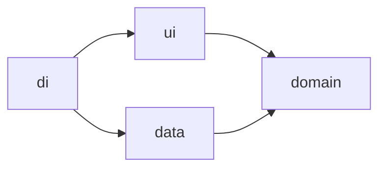

# Архитектура Android-приложения

Приложение построено по MVVM и Clean Architecture. Слои — пакеты модуля `app` (`ru.voploshchenie.app`); зависимости направлены внутрь:

| Слой | Что внутри | Зависит от |
|---|---|---|
| `domain` | модели, правила расчёта (`scoring`, `games`), use case, интерфейсы репозиториев | только Kotlin и JDK |
| `data` | реализации репозиториев, Room, загрузчики ассетов, SharedPreferences, мапперы | `domain` |
| `ui` | экраны на Compose, навигация, `ViewModel` и состояния экранов | `domain` |
| `di` | модули Hilt, связывающие интерфейсы `domain` с реализациями `data` | все слои |

## MVVM

Каждый экран состоит из `Route` (получает `ViewModel` через Hilt и собирает `StateFlow` с учётом жизненного цикла) и «глупого» `Screen`, который рисует состояние и вызывает переданные колбэки. `ViewModel` не знает про Compose и Android-виджеты и общается только с интерфейсами из `domain`. Состояние экрана — один неизменяемый `data class` или `sealed interface` (`Loading`, `Content`, `Error`).

## Данные

- Каталог возможностей и конфигурация теста лежат в `assets` и читаются загрузчиками из `data/local/asset`. `OpenCatalogRepository` объединяет основной каталог с `catalog_extra.json` и убирает завершившиеся возможности.
- Ответы теста, сохранённое и результаты хранятся в Room; прогресс мини-игр — в SharedPreferences (`PrefsGameProgressRepository`).
- Ежедневное задание игр выбирается детерминированно по номеру дня (хэш FNV-1a и перемешивание по кругам), поэтому веб и Android показывают одно и то же.

## Тесты

Правила `domain` проверяются обычными юнит-тестами (`GamesDomainTest`, `ScoringEngineTest`, `CatalogSelectionTest`), экраны и потоки — Compose-тестами на Robolectric.
